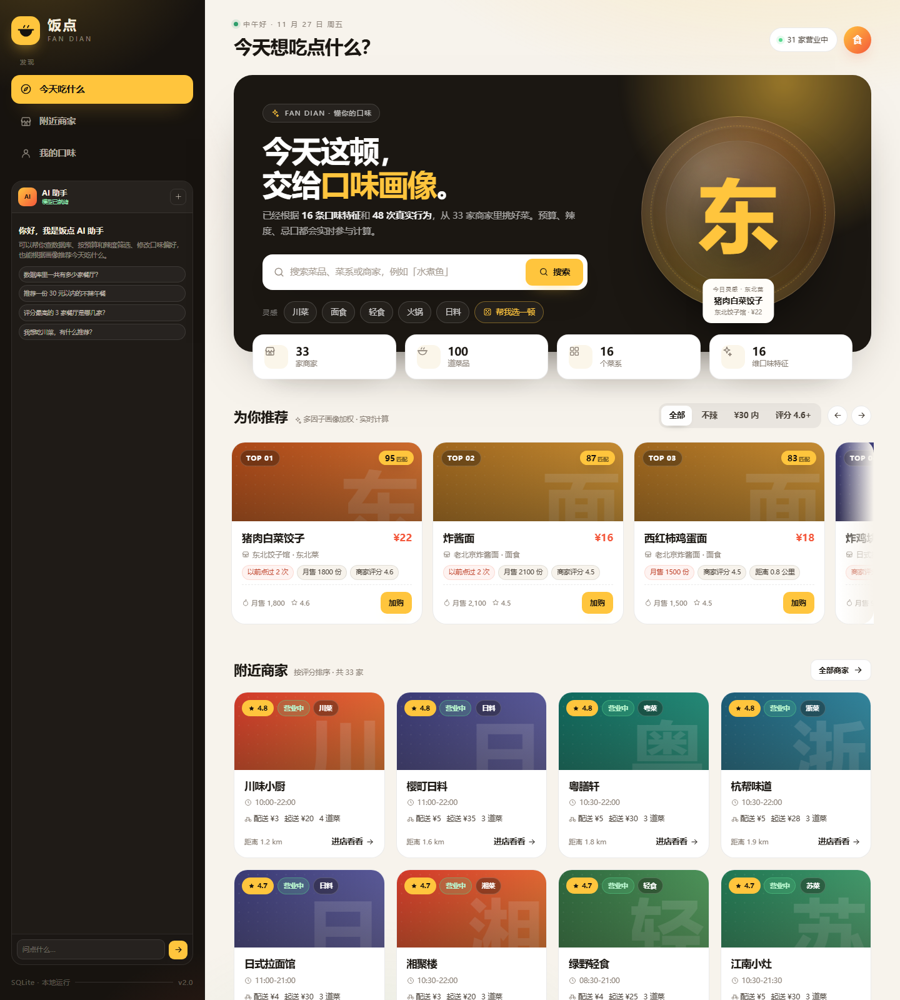
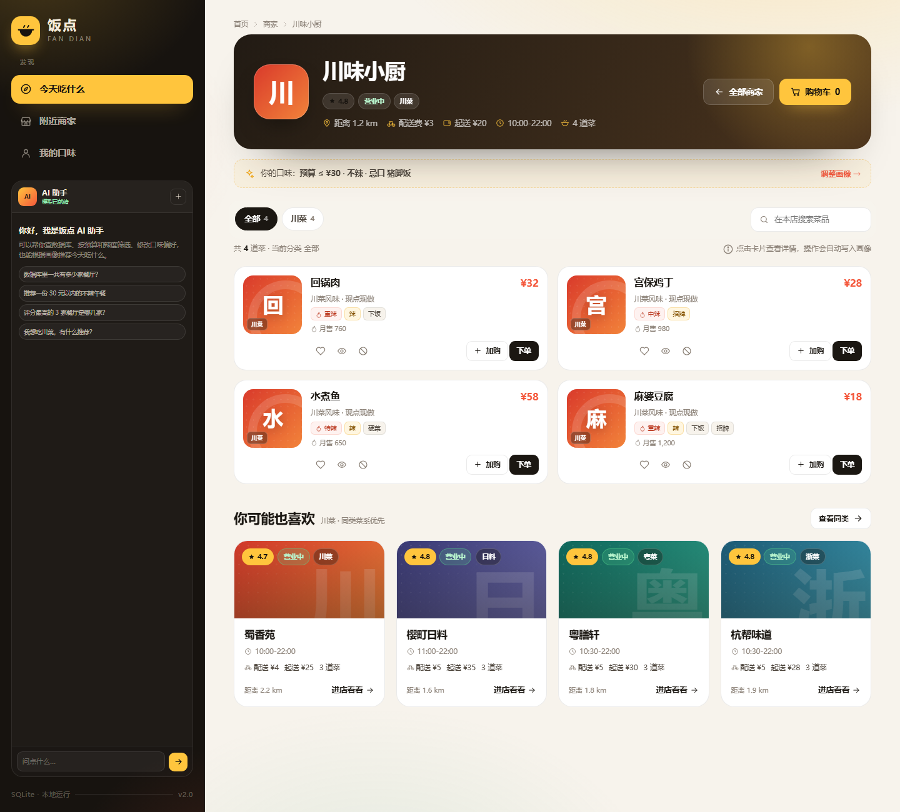
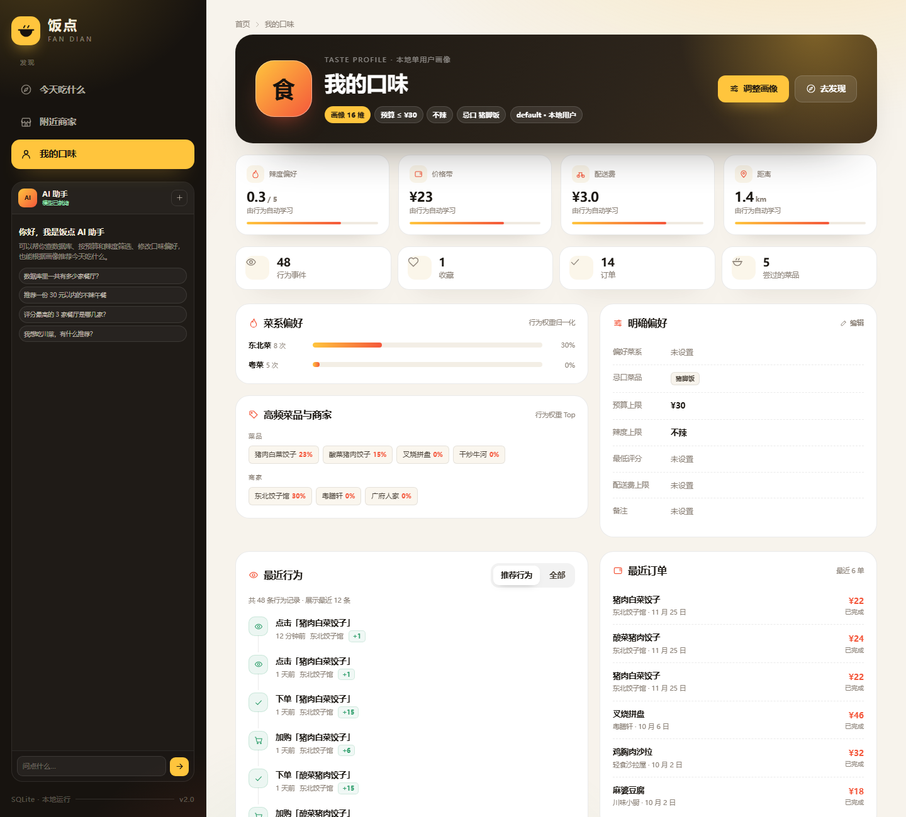
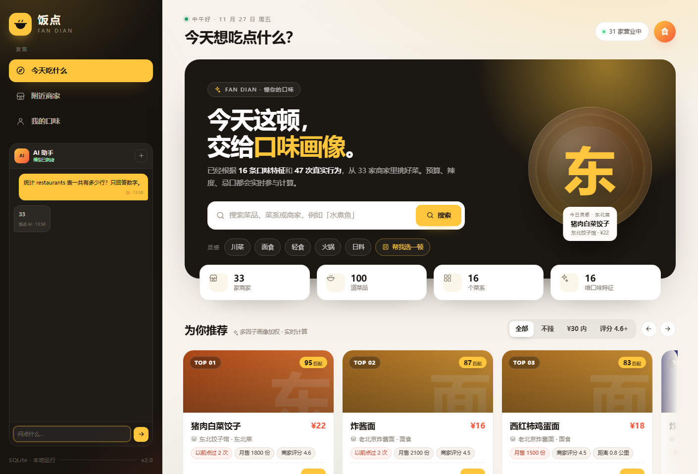

# 饭点 · 前端说明

新版前端是项目里一套可以直接运行的「外卖推荐 + 用户画像」界面。它不依赖
Node.js、npm 或任何前端构建工具，由 `meituan_sim.server` 直接托管静态资源，
数据全部来自本地 SQLite（`data/agent.db`）和现有的推荐算法。

## 1. 启动与访问

最简单的方式是双击项目根目录的 `启动后端.bat`，它会自动启动服务并打开浏览器。
详细部署、日志、停止和局域网访问见 [本地部署说明.md](本地部署说明.md)。

也可以手动启动：

```powershell
cd <项目目录>
python -m meituan_sim.server
```

浏览器打开：

```text
http://127.0.0.1:18080/
```

| 页面 | 地址 | 说明 |
| --- | --- | --- |
| 发现 | `/` | 今日推荐、口味摘要、附近商家 |
| 商家 | `/stores` | 菜系筛选、排序、商家搜索 |
| 菜单 | `/menu?ePoiId=4211` | 菜品分类、店内搜索、加购下单 |
| 口味画像 | `/profile` | 明确偏好、行为画像、行为时间线、订单 |
| 搜索 | `/search?q=面` | 商家与菜品全局搜索 |

AI 助手不再是独立页面，也不使用浮动弹窗：它固定在首页左侧目录栏下方，顶部是
标题和模型状态，下面直接是聊天记录和输入框，可以边看首页边对话。
移动端会把同一个对话面板放到首页内容区。旧的 `/chat` 地址会重定向到首页。

原来的 `/stores`、`/menu`、`/profile` 地址保持不变，只是改成由同一套前端
应用接管，旧的书签和文档链接仍然可用。

## 2. 界面预览









## 3. 功能

- **今日推荐**：首页调用 `storage.recommend_dishes()`，展示匹配分、推荐理由、
  月售、评分，并支持「全部 / 不辣 / ¥30 内 / 评分 4.6+」筛选。
- **今日灵感**：Hero 右侧的圆形插画展示当前排名第一的菜，点击可直接查看详情。
- **帮我选一顿**：从推荐池里随机挑一道菜，适合选择困难场景。
- **商家目录**：16 个菜系筛选、评分/距离/配送费/起送价/菜品数排序、关键词搜索、
  营业状态与距离展示。
- **商家菜单**：店内菜品分类、店内搜索、菜品详情弹窗、收藏 / 详情 / 加购 /
  下单 / 不感兴趣 / 五星评分，所有操作都会写入行为画像。
- **购物车**：同店加购、数量调整、合计金额、一键提交订单；跨店加购会自动切换。
- **口味画像**：
  - 明确偏好（预算、辣度、评分、配送费、偏好菜系、忌口、备注）可直接在网页修改；
  - 行为画像展示菜系权重、高频菜品、常点商家、价格/辣度/配送/距离指标；
  - 行为时间线区分「推荐行为 / 全部」，避免大量搜索记录挤占视野；
  - 最近订单与画像统计同屏展示。
- **全局搜索**：同时搜索商家和菜品，支持按菜名、标签、菜系、商家名匹配。
- **左侧 AI 对话**：固定在首页左侧目录栏下方，可直接输入对话；可查数据库、
  按预算/辣度筛选、改偏好、生成推荐；支持对话历史、新对话、快捷问题、
  Markdown 表格与内部商家链接跳转。不是独立页面，也不占用主内容区。
  移动端会自动把面板放到首页内容区。需要先启动 Ollama（双击 `启动AI后端.bat`）。
- **响应式**：桌面端左侧固定导航，≤980px 切换为顶部品牌栏 + 底部 Tab 栏；
  1440 / 1280 / 820 / 500 宽度均已检查。

## 4. 设计说明

- 色彩：暖米色背景 `#F7F3EC` + 墨色 `#1B1712` + 品牌黄 `#FFC53D` +
  番茄橙 `#F4573B`，贴合外卖场景又避免廉价的大红大黄。
- 没有菜品图片时，用「菜系字符 + 渐变色」生成封面，同一种菜系有稳定配色，
  不同菜系之间又能快速区分。
- 字体：`PingFang SC / HarmonyOS Sans SC / Microsoft YaHei`，不引入外部字体。
- 动效：卡片悬浮、页面淡入、抽屉滑入、弹窗缩放、Toast、骨架屏，均支持
  `prefers-reduced-motion`。
- 视觉变量集中在 `meituan_sim/web/styles.css` 顶部的 `:root`，改主色只需要
  调整几个变量。

## 5. 目录结构

```text
meituan_sim/
├─ server.py          # 静态资源 + JSON API + 美团模拟接口
└─ web/
   ├─ index.html      # SPA 外壳、SVG 图标 sprite
   ├─ styles.css      # 设计系统与响应式样式
   ├─ app.js          # 路由、页面渲染、购物车、画像编辑、AI 对话
   └─ favicon.svg
```

前端使用 History API 路由：`/`、`/stores`、`/menu`、`/profile`、`/search`。
AI 对话面板固定在 `index.html` 的侧边栏 `#sidebarChatMount` 中；≤980px 时
`placeChatPanel()` 会把同一个 `#sideChat` 移到首页的 `#mobileChatMount`。
旧的 `/chat` 会重定向到首页。
刷新任意地址都由服务端返回同一个 `index.html`，再由 `app.js` 按路径渲染，
不需要额外的 fallback 配置。

## 6. JSON API

| 方法 | 地址 | 用途 |
| --- | --- | --- |
| GET | `/api/restaurants?category=&q=&sort=&max_fee=` | 商家列表、菜系聚合、统计数据 |
| GET | `/api/menu?ePoiId=4211` | 商家信息 + 菜品 + 分类 + 明确偏好 |
| GET | `/api/recommendations?limit=8&max_price=&max_spicy=&category=&min_rating=` | 个性化推荐 |
| GET | `/api/profile` | 画像摘要 + 行为事件 + 最近订单 + 统计 |
| GET | `/api/search?q=面` | 商家 + 菜品搜索 |
| GET | `/api/chat/status` | Ollama / 模型是否就绪 |
| GET | `/api/chat/history?session_id=web-xxx` | 网页对话历史 |
| POST | `/api/chat` | 发送对话：`{message, session_id}`，调用 `NL2SQLAgent` |
| POST | `/api/action` | 行为上报与下单：`click`、`detail_view`、`favorite`、`cart_add`、`dismiss`、`not_interested`、`order`、`rating`、`search` |
| POST | `/api/preferences` | 写入 / 删除明确偏好：`{key, value}` 或 `{key, delete: true}` |

行为上报沿用原有 `TakeoutStorage.record_event()` / `record_order()`，因此和
CLI、Agent 共用同一套画像与权重逻辑。`/api/chat` 内部复用 `nl2sql.NL2SQLAgent`
和 `TakeoutDatabase`，与命令行 AI 共用会话存储和工具注册表。

## 7. 已验证

- `python -m py_compile meituan_sim/server.py meituan_sim/repository.py storage.py`
  通过；
- 在临时数据库副本上跑通菜单、推荐、搜索、画像、行为上报、偏好增删、
  旧版 `/ui/action` 表单、以及美团签名接口 `queryFoodList` / `queryCatList`；
- 用无头 Edge + CDP 实际操作了「加购 → 打开购物车 → 提交订单 → 菜品详情 →
  五星评分 → 打开画像 → 修改预算和辣度 → 保存」，页面无 JS 报错；
- 用 CDP 实际操作左侧 AI 对话：「统计餐厅数量 → 33」，验证了历史保留、
  时间显示和 Markdown 表格；推荐问题也能在面板内生成商家表格；
- 用 CDP 把视口切到 500px，确认 `#sideChat` 会移动到首页
  `#mobileChatMount` 并保持可对话；
- 截图覆盖 1440、1280、820、500 宽度。

## 8. 二次开发

- 改主色 / 圆角 / 阴影：`styles.css` 的 `:root`。
- 改页面结构：`app.js` 里按 `renderDiscover` / `renderStores` / `renderMenu` /
  `renderProfile` / `renderSearch` 划分。
- AI 对话：`#sideChat` 固定在侧边栏；`placeChatPanel()` 负责在桌面侧边栏与
  移动端首页 `#mobileChatMount` 之间移动，`initSideChat()` 加载状态和历史，
  `sendChatMessage()` 调用 `/api/chat`。
- 新增 API：在 `server.py` 的 `do_GET` / `do_POST` 中注册，并复用
  `MeituanDishRepository`、`TakeoutStorage`。
- 菜品图片：`dishes.picture` / `meituan_dishes.picture` 已经有字段，当前封面是
  降级方案；接入真实图片时把 `dish-thumb` 的渐变封面替换成 `` 即可。
